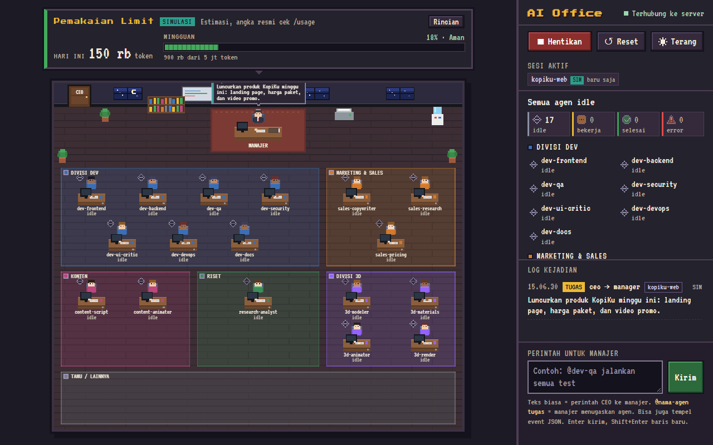
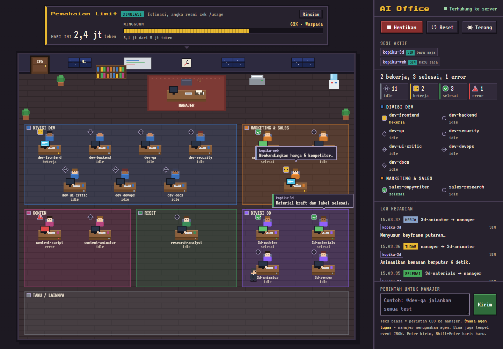
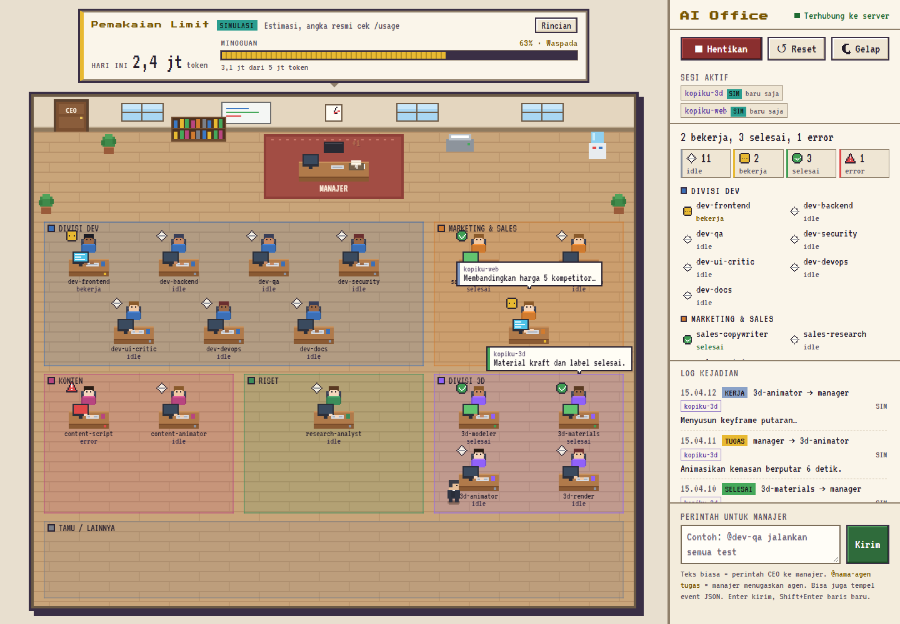

# AI Office

[](https://github.com/mansgaming712-hue/ai-office/actions/workflows/ci.yml)
[](LICENSE)

[English](README.md)

AI Office adalah kantor pixel art yang menampilkan subagen Claude Code yang sedang bekerja. Sesi Claude Code
utama bertindak sebagai manajer dan mendelegasikan tugas ke 17 agen spesialis; dashboard menganimasikan setiap
delegasi, dari penugasan sampai laporan. Proyek ini berupa server Node lokal kecil yang menerima kejadian dari
hook Claude Code, ditambah dashboard React yang menggambar kantor di canvas.







Tangkapan layar dan demo memakai data simulasi, bukan sesi sungguhan.

## Fitur

- **Kantor pixel art** di canvas: manajer, meja worker, dan amplop laporan.
- **Simulasi**: tombol ▶ Simulasi memutar skenario contoh sekitar 60 detik tanpa Claude Code.
- **Kotak perintah**: teks biasa dikirim ke manajer, `@nama-agen` menugaskan agen tertentu, dan kamu bisa menempel
  event JSON.
- **Hooks Claude Code**: delegasi dari sesi Claude Code sungguhan dikirim ke dashboard secara otomatis.
- **Sesi aktif**: daftar proyek yang punya event dalam 10 menit terakhir.
- **Panel Pemakaian Limit**: estimasi pemakaian token dari log lokal Claude Code. Ini bukan angka resmi.
- **Mode lokal atau mode token**: mode lokal hanya bisa diakses dari komputer ini. Mode token untuk akses jarak
  jauh di belakang HTTPS (lihat [Deploy ke VPS](#deploy-ke-vps)).
- **Tema gelap dan terang**: default mengikuti pengaturan sistem dan disimpan di browser.
- **Empat status agen**: `idle`, `bekerja`, `selesai`, dan `error`. `error` berarti agen melapor
  `STATUS: BUTUH BANTUAN`. Setiap status punya ikon, label, dan jumlah.
- **Tata letak responsif** dari ponsel sampai layar besar. Animasi menghormati `prefers-reduced-motion`.
- **Autostart** untuk Windows, macOS, dan Linux (opsional, tanpa hak admin).
- **Validasi dan test**: `npm run agents:validate` dan `npm test`.

Teks UI, pesan server, dan definisi agen memakai bahasa Indonesia. Terjemahan sangat diterima.

## Persyaratan

| Kebutuhan | Versi | Keterangan |
| --- | --- | --- |
| Node.js | 22.12 atau lebih baru | Satu angka minimal untuk semuanya: server, hooks, build, dan test. Dicek oleh `server/requireNode.js` (juga sebelum `npm run build` dan `npm test`). Versi lebih lama menampilkan pesan lalu keluar dengan kode 1. |
| npm | ikut terpasang bersama Node.js | |
| Claude Code (CLI `claude`) | versi terbaru yang wajar | Hanya untuk delegasi sungguhan. Mode simulasi tidak membutuhkannya. |

Cek versimu dengan `node -v`.

## Install

Perintah setelah langkah Node.js sama untuk bash, zsh, dan PowerShell.

### Windows

1. Pasang Node.js 22 LTS atau lebih baru, dengan `winget install OpenJS.NodeJS.LTS` di PowerShell atau dari
   https://nodejs.org/. Buka terminal baru setelah itu.
2. Pasang Git bila belum ada: https://git-scm.com/.
3. Jalankan:

```powershell
git clone https://github.com/mansgaming712-hue/ai-office.git
cd ai-office
npm ci
npm run agents:install
npm run hooks:install-user
```

### macOS

1. Pasang Node.js 22 LTS atau lebih baru, dengan Homebrew (`brew install node`) atau installer dari
   https://nodejs.org/. Cek dengan `node -v`.
2. Jalankan:

```bash
git clone https://github.com/mansgaming712-hue/ai-office.git
cd ai-office
npm ci
npm run agents:install
npm run hooks:install-user
```

### Linux

1. Pasang Node.js 22 dengan pengelola versi seperti [nvm](https://github.com/nvm-sh/nvm) atau
   [fnm](https://github.com/Schniz/fnm). Paket bawaan distro sering terlalu lama, jadi cek dulu dengan `node -v`.

```bash
nvm install 22
nvm use 22
```

2. Jalankan:

```bash
git clone https://github.com/mansgaming712-hue/ai-office.git
cd ai-office
npm ci
npm run agents:install
npm run hooks:install-user
```

Fungsi tiga perintah terakhir:

- `npm run agents:install` menyalin `agents/*.md` ke `~/.claude/agents/` (di Windows, `%USERPROFILE%\.claude\agents\`).
  File yang sudah ada dan berbeda tidak ditimpa. Tambahkan `-- --force` untuk menimpanya.
- `npm run hooks:install-user` memasang hook AI Office ke `~/.claude/settings.json`. Pemasang menggabungkan dengan
  pengaturan yang ada, membuat backup sebelum menulis, dan aman dijalankan berulang. Pemasang menolak path folder
  proyek yang memuat `"`, baris baru, `$`, backtick, `%`, atau `!`, karena command hook dijalankan lewat shell.
  Pindahkan proyek ke folder lain bila ditolak.
- Hook hanya aktif untuk sesi Claude Code yang dimulai **sesudah** pemasangan. Buka ulang sesi yang sudah berjalan.
  Untuk melepas hook: `npm run hooks:uninstall-user`.

## Menjalankan

```bash
npm start
```

PowerShell memakai perintah yang sama. Buka **http://localhost:3000**. `npm start` membangun UI (`prestart`) lalu
menjalankan server.

- Kalau UI sudah pernah dibangun, pakai `npm run serve` untuk menjalankan server tanpa build.
- Port lain: `PORT=3001 npm run serve` (bash, zsh) atau `$env:PORT=3001; npm run serve` (PowerShell).
- **▶ Simulasi** memutar skenario contoh tanpa Claude Code. **↺ Reset** mengosongkan kantor dan log.
- **Kotak perintah**: teks biasa adalah perintah ke manajer. `@dev-qa jalankan test` meminta manajer menugaskan agen
  tersebut. Klik meja atau nama agen untuk mengisi `@nama`.
- Untuk delegasi sungguhan, jalankan `claude` di folder proyek. Aturan di `CLAUDE.md` berlaku untuk sesi yang
  dimulai dari folder ini.

## Autostart

Autostart menyalakan server AI Office saat kamu login. Fitur ini opsional. Dalam pengaturan ini server hanya
mendengar di `127.0.0.1:3000`. Jalankan perintah dari folder proyek. Perintahnya sama di bash, zsh, dan PowerShell.

```bash
npm run autostart:install      # pasang autostart dan nyalakan server
npm run autostart:status       # tampilkan keadaan autostart dan server (hanya membaca)
npm run autostart:stop         # hentikan server sekarang; autostart tetap terpasang
npm run autostart:uninstall    # lepas autostart dan hentikan server
```

Untuk melihat apa yang akan ditulis pemasangan tanpa mengubah apa pun:

```bash
node scripts/autostart.mjs install --dry-run
```

### Autostart: Windows

- Membuat shortcut bernama "AI Office" di folder Startup pengguna. Tidak butuh hak admin.
- Peluncur tersembunyi (`scripts/windows/start-ai-office.vbs`) menjalankan supervisor. Supervisor menyalakan ulang
  server setelah crash, dengan jeda 5, 10, 20, 40, lalu 60 detik. Setelah 8 crash beruntun, supervisor berhenti.
- Log server: `logs/server.log`. Saat lebih dari 5 MB, log dipindah ke `logs/server.log.1`.
- Kalau server sudah berjalan dari `npm start` di port 3000, autostart tidak menjalankan salinan kedua.

### Autostart: macOS

- Membuat LaunchAgent di `~/Library/LaunchAgents/com.ai-office.server.plist` lalu memuatnya dengan `launchctl`.
  Tidak butuh hak admin.
- Log server: `logs/server.log` di folder proyek.

### Autostart: Linux

- Membuat unit systemd user di `~/.config/systemd/user/ai-office.service`. Butuh `systemctl --user`, jadi sesi login
  biasa diperlukan.
- Server menyala saat kamu login. Agar tetap jalan tanpa login (misalnya di mesin tanpa layar), jalankan sendiri
  perintah berikut. Pemasang tidak menjalankannya otomatis:

```bash
sudo loginctl enable-linger "$USER"
```

- Log: `journalctl --user -u ai-office.service -f`.

### Catatan autostart (semua platform)

- Pemasang mencatat path executable Node.js yang dipakai saat pemasangan. Kalau kamu berganti versi Node.js lewat
  nvm, fnm, asdf, atau Volta, jalankan `npm run autostart:install` lagi. Path lama bisa sudah tidak ada. Pemasang
  belum memberi peringatan untuk kasus ini.
- Autostart menjalankan `server/index.js` dari folder proyek setiap kamu login, dan hook level user menjalankan
  `hooks/send-event.mjs` di setiap sesi Claude Code. Simpan proyek di folder yang hanya bisa ditulis akunmu
  sendiri, supaya orang lain tidak bisa mengubah kode yang berjalan atas namamu.

## Konfigurasi

### `.env`

```bash
cp .env.example .env
```

```powershell
Copy-Item .env.example .env
```

- Semua isi `.env.example` boleh kosong. Tanpa isi, server berjalan di mode lokal (`127.0.0.1:3000`, tanpa login).
- File `.env` tidak ikut ke git. Jangan pernah commit `.env`.
- Variabel yang sudah ada di environment (shell, systemd, atau bagian `env` di `settings.json` Claude Code) **tidak**
  ditimpa oleh `.env` (lihat `server/loadEnv.js`).
- Server dan hook (`hooks/send-event.mjs`) sama-sama membaca `.env` dari folder proyek.
- Pemuatan `.env` memakai `process.loadEnvFile` bawaan Node, jadi tidak butuh paket tambahan.
- Daftar lengkap variabel ada di [Variabel lingkungan](#variabel-lingkungan).

### `limit-config.json` (opsional)

```bash
cp limit-config.example.json limit-config.json
```

```powershell
Copy-Item limit-config.example.json limit-config.json
```

Isi `weeklyTokenLimit` dengan perkiraan batas token per minggu. Bar batas di panel hanya muncul bila angkanya lebih
dari 0. File ini tidak ikut ke git. Penjelasan setiap kunci ada di [Konfigurasi limit](#konfigurasi-limit).

## Agen

17 spesialis didefinisikan di `agents/` (sumber). `npm run agents:install` memasangnya ke `~/.claude/agents/`.

| Divisi | Agen |
| --- | --- |
| Dev | dev-frontend, dev-backend, dev-qa, dev-security, dev-ui-critic, dev-devops, dev-docs |
| Marketing & Sales | sales-copywriter, sales-research, sales-pricing |
| Konten | content-script, content-animator |
| Riset | research-analyst |
| 3D | 3d-modeler, 3d-materials, 3d-animator, 3d-render |

Setiap agen menulis modelnya di field `model:` pada frontmatter. Hanya `haiku` dan `sonnet` yang diizinkan.
`haiku` dipakai oleh dev-docs, research-analyst, dan 3d-render; `sonnet` dipakai oleh sisanya. Validasi di
`scripts/agent-files.mjs` menolak nilai lain, misalnya `opus`.

Aturan manajer ada di `CLAUDE.md`.

```bash
npm run agents:validate                # cek frontmatter, nama unik, model, aturan spesialis, salinan terpasang
npm run agents:install                 # pasang atau perbarui di ~/.claude/agents (file berbeda tidak ditimpa)
npm run agents:install -- --force      # timpa juga file yang berbeda
```

Setelah menarik perubahan yang menambah agen, jalankan `npm run agents:install`. Sebelum itu,
`npm run agents:validate` melaporkan agen tersebut belum terpasang.

## Format event

Semua kejadian (simulasi, kotak perintah, dan hooks) memakai satu format:

```json
{ "type": "assign", "from": "manager", "to": "dev-frontend", "message": "Bangun navbar", "time": "2026-11-08T02:30:00.000Z" }
```

- `type`: `assign` | `working` | `done` | `blocked` | `report`
- Kunci bahasa Indonesia juga diterima: `tipe`, `dari`, `ke`, `pesan`, `waktu`.
- `time` boleh dikosongkan; server yang mengisinya. Nama khusus: `manager` dan `ceo`.
- `project` (opsional): nama folder sesi Claude Code, maksimal 64 karakter. Diisi oleh hook.
- `tokens` (opsional): `{ input, output, cacheRead, cacheCreation }`, hanya dikirim bersama `SubagentStop`. Dipakai
  untuk statistik pemakaian per agen.

Mengirim event secara manual:

```bash
curl -X POST http://localhost:3000/api/events \
  -H "Content-Type: application/json" \
  -d '{"type":"done","from":"dev-qa","to":"manager","message":"9 test lulus"}'
```

```powershell
Invoke-RestMethod -Method Post -Uri http://localhost:3000/api/events -ContentType 'application/json' `
  -Body '{"type":"done","from":"dev-qa","to":"manager","message":"9 test lulus"}'
```

Dalam mode token, tambahkan header `Authorization: Bearer <token-kamu>`. Di bash: `-H "Authorization: Bearer $AI_OFFICE_TOKEN"`.
Di PowerShell: `-Headers @{ Authorization = "Bearer $env:AI_OFFICE_TOKEN" }`. Lihat
[Autentikasi dan mode server](#autentikasi-dan-mode-server).

| Endpoint | Fungsi | Mode token |
| --- | --- | --- |
| `POST /api/events` | satu event atau array (maksimal 50). Wajib `Content-Type: application/json` | wajib header Bearer atau cookie sesi, tanpa itu `401` |
| `GET /api/events` | 300 event terakhir | wajib header Bearer atau cookie sesi, tanpa itu `401` |
| `GET /api/usage` | `{ok, usage}`: statistik pemakaian token (estimasi lokal) | wajib header Bearer atau cookie sesi, tanpa itu `401` |
| `GET /api/health` | status server. Hanya menjawab `{ok:true}`, tanpa jumlah klien atau event | terbuka |
| `GET /api/session` | `{ok, authRequired, authenticated}` | terbuka |
| `POST /api/login` | body `{"token":"..."}` (JSON). Memasang cookie `aio_session`. Salah: `401`. Terlalu sering: `429` | terbuka (mode lokal selalu `{ok:true}`) |
| `POST /api/logout` | menghapus cookie sesi di browser itu. Wajib `Content-Type: application/json` (body boleh `{}`) | terbuka |
| `WS /ws` | mengirim `{kind:"hello", events}`, lalu `{kind:"usage", usage}`, lalu `{kind:"event", event}` dan `{kind:"usage", usage}` saat ada perubahan | wajib header Bearer atau cookie sesi, tanpa itu `401`. Ditutup dengan kode `4401` saat sesi kedaluwarsa |

## Hooks Claude Code

Hook Claude Code dipasang di **level user** (`~/.claude/settings.json`), sehingga berlaku untuk sesi dari folder mana
pun. File `.claude/settings.json` proyek berisi `{}` dan tidak memasang hook apa pun.

```bash
npm run hooks:install-user     # pasang hook AI Office ke ~/.claude/settings.json
npm run hooks:uninstall-user   # lepas hook AI Office dari ~/.claude/settings.json
```

Pemasang (`scripts/install-user-hooks.mjs`, logika bersama di `scripts/user-hooks.mjs`):

- **Menggabung, tidak menimpa.** Key dan hook lain di settings dibiarkan. Dijalankan berkali-kali tidak menambah
  entri ganda (idempoten).
- **Backup.** Sebelum menulis, file lama disalin ke `~/.claude/settings.json.bak-YYYYMMDD-HHMMSS` (kalau nama itu
  sudah ada, ditambah `-1`, `-2`, dan seterusnya). Kalau `settings.json` belum ada, tidak ada backup.
- **Tulis atomik** (file sementara lalu rename). Kalau JSON settings yang ada rusak, tidak ada yang ditulis dan kode
  keluarnya `1`.
- **Path proyek dicek.** Lihat daftar di bagian [Install](#install).
- **Path absolut.** Command hook memakai path absolut `hooks/send-event.mjs` dari folder tempat pemasang dijalankan.
  Kalau proyek dipindah, pasang ulang dari lokasi baru. Entri dari lokasi lama tidak dikenali dari lokasi baru. Jalankan
  dulu `npm run hooks:uninstall-user` dari folder lama, atau hapus manual entri `send-event.mjs` yang lama dari
  `settings.json` (setelah membuat backup).
- **Berlaku untuk sesi baru.** Sesi yang sudah berjalan perlu dibuka ulang.
- Untuk uji tanpa menyentuh settings asli, arahkan `AI_OFFICE_USER_SETTINGS` ke file lain (lihat
  [Variabel lingkungan](#variabel-lingkungan)).

Hook yang dipasang (event dan matcher sama dengan `desiredHooks` di `scripts/user-hooks.mjs`):

| Hook | Event AI Office |
| --- | --- |
| `PreToolUse` dengan tool `Agent` atau `Task` | `assign` dari manajer ke subagen (pesan = deskripsi tugas) |
| `SubagentStart` | `working` untuk subagen |
| `PreToolUse` dengan tool lain (async) | `working` dari subagen (atau manajer), misalnya `Edit · App.jsx` |
| `SubagentStop` | `done` atau `blocked`, dibaca dari baris `STATUS:` pada laporan |
| `PostToolUse` dengan tool `Agent` atau `Task` | `report` atau `blocked`, dengan ringkasan laporan |

Perilaku saat berjalan:

- Claude Code menunggu hook paling lama **3 detik** (timeout yang ditulis pemasang).
- Hook mengirim event ke server dengan batas **800 ms** (`AI_OFFICE_TIMEOUT_MS`, default di `hooks/send-event.mjs`).
  Event tidak dikirim ulang.
- Kalau server mati, hook diam-diam keluar dengan kode 0 tanpa output, sehingga Claude Code tidak terganggu. Event yang
  gagal terkirim tidak dicatat di mana pun, kecuali dengan `AI_OFFICE_DEBUG=1`.
- Setiap event membawa `project`: nama folder sesi (basename `CLAUDE_PROJECT_DIR`, atau cwd bila variabel itu kosong).
  Daftar **Sesi aktif** menampilkan sesi yang punya event dalam 10 menit terakhir.
- Event `SubagentStop` juga membawa `tokens` dari transkrip subagen untuk statistik per agen.
- Pola rahasia umum (token, API key, password) disembunyikan sebelum dikirim.
- Kalau event yang identik (type, from, to, message, project) datang lagi dalam 3 detik, server membuangnya supaya
  animasi tidak dobel.

Uji tanpa Claude Code (server harus berjalan):

```bash
npm run demo:hooks              # skenario contoh, jeda sekitar 1,8 detik antar langkah
npm run demo:hooks -- --fast    # tanpa jeda
npm run demo:hooks -- --asli    # bentuk payload Claude Code terbaru: agen latar belakang dan laporan
                                # lewat SubagentHandback yang dibaca dari file transkrip
```

Mengirim event hook ke server lain: `AI_OFFICE_URL=http://127.0.0.1:3001/api/events`. Debug: `AI_OFFICE_DEBUG=1`.

Belum diuji di kode ini: apakah bagian `"env"` di `~/.claude/settings.json` meneruskan variabel ke hook level user.
Untuk sementara, simpan variabel hook di `.env` atau di environment sistem.

## Panel Pemakaian Limit

Panel "Pemakaian Limit" di atas kantor menampilkan **estimasi** pemakaian token Claude Code. Angka resmi ada di
`/usage` di dalam Claude Code. Panel tidak memanggil model atau API apa pun.

- **Sumber:** log lokal `~/.claude/projects/**/*.jsonl` (termasuk `subagents/`). Token dihitung dari `message.usage`,
  dedup per `message.id`, dan dikelompokkan per jam lokal. Token per agen berasal dari event SubagentStop (window 7 hari).
- **Kapan dihitung ulang:** tiap 60 detik, dan sekitar 2 detik setelah event SubagentStop yang membawa `tokens`.
- **Rumus mingguan:** input + output + cache tulis, ditambah cache baca bila `countCacheRead` bernilai `true`.
- **Warna bar:** hijau di bawah 60%, kuning 60–85%, merah di atas 85%. Di atas 85%, panel menampilkan peringatan
  "Limit hampir habis, hemat mode". Bar hanya muncul bila `weeklyTokenLimit` diisi.
- **Data tidak tersedia:** kalau log tidak bisa dibaca (folder tidak ada, kosong, atau formatnya tidak dikenali),
  panel menampilkan "data tidak tersedia" beserta alasannya.
- **Privasi:** hasil dan log hanya berisi angka dan nama agen. Tidak ada path, isi pesan, atau nama sesi.
- **Cache:** `data/usage-cache.json` dan `data/usage-agents.json`, dibuat otomatis. Folder `data/` tidak ikut ke git.

### Konfigurasi limit

Isi `limit-config.json` di root proyek. Contoh referensi ada di `limit-config.example.json`. Angka di bawah hanya contoh:

```json
{
  "weeklyTokenLimit": 5000000,
  "weekResetDay": 1,
  "weekResetHour": 0,
  "countCacheRead": false
}
```

| Kunci | Isi | Keterangan |
| --- | --- | --- |
| `weeklyTokenLimit` | angka di atas 0, atau `0` | perkiraan batas token per minggu. `0` = tanpa batas (bar tidak tampil) |
| `weekResetDay` | `0`–`6` atau `null` | hari reset (0 = Minggu, 1 = Senin, ..., 6 = Sabtu). `null` = window bergulir 7 hari |
| `weekResetHour` | `0`–`23` | jam reset, waktu lokal komputer. Default `0` |
| `countCacheRead` | `true` / `false` | `true` = token cache baca ikut dihitung. Default `false` |

File dibaca ulang setiap siklus, jadi server tidak perlu di-restart. Lokasi lain bisa diatur dengan
`AI_OFFICE_LIMIT_CONFIG`. JSON yang rusak dianggap tidak ada.

### CLI dan data contoh

```bash
npm run usage                 # ringkasan di terminal (estimasi)
npm run usage -- --json       # keluaran JSON, bentuknya sama dengan GET /api/usage → usage
```

`npm run usage` tidak membutuhkan server. Kode keluarnya selalu `0`, termasuk saat data tidak tersedia.

Data contoh, saat tidak ada log Claude Code asli:

```bash
npm run usage:sample                                               # tulis tests/fixtures/usage-sample/
AI_OFFICE_CLAUDE_DIR=tests/fixtures/usage-sample npm run usage     # bash, zsh
```

```powershell
npm run usage:sample
$env:AI_OFFICE_CLAUDE_DIR = "tests\fixtures\usage-sample"; npm run usage; Remove-Item Env:AI_OFFICE_CLAUDE_DIR
```

`npm run usage:sample` menghapus folder `projects/` di dalam folder tujuan sebelum menulis ulang. Jangan arahkan ke
folder log Claude Code yang asli.

`AI_OFFICE_CLAUDE_DIR` menunjuk folder dasar log (default `~/.claude`). Kalau folder itu tidak punya subfolder
`projects/`, folder itu sendiri yang dipindai.

## Autentikasi dan mode server

Perlindungan yang selalu aktif: header `Host` diperiksa (melindungi dari DNS rebinding), `Origin` dari situs lain
ditolak untuk API dan WebSocket, body dibatasi 64 KB, halaman dikirim dengan Content Security Policy yang ketat, dan
log server secara default hanya mencatat metadata event (tipe, pengirim, penerima, panjang pesan). Server punya tiga mode:

1. **Mode lokal** (default). Tanpa token, server hanya mendengar di `127.0.0.1` dan hanya bisa dibuka dari komputer
   ini. Tidak ada login.
2. **Mode token**. Aktif bila `AI_OFFICE_TOKEN` atau `AI_OFFICE_TOKEN_FILE` terisi.
   - Browser menampilkan layar token. Setelah token benar, server memasang cookie `aio_session` (HttpOnly,
     SameSite=Strict, dan `Secure` bila lewat HTTPS) yang berlaku 7 hari. Tombol **Keluar** hanya menghapus cookie
     di browser itu. Mengganti token membatalkan semua sesi.
   - Hooks dan curl mengirim header `Authorization: Bearer <token>`.
   - Login gagal 10 kali dari satu IP diblokir 15 menit (`429`).
   - Token tidak pernah ditulis ke log, respons, atau URL.
3. **Mode terbuka**. Terjadi bila `HOST` bukan loopback, `AI_OFFICE_ALLOWED_HOSTS` terisi, atau
   `AI_OFFICE_TRUST_PROXY=1`. Wajib token minimal 32 karakter; tanpa itu server menolak start (kode keluar 1).
   `AI_OFFICE_TRUST_PROXY=1` juga hanya boleh dipakai dengan `HOST` loopback (Nginx di mesin yang sama). Untuk akses
   internet, ikuti panduan [Deploy ke VPS](#deploy-ke-vps) (Nginx dan HTTPS).

Buat token yang kuat (32 byte acak, 43 karakter) dan jalankan mode token di komputer sendiri.

Bash, zsh (Linux, macOS, Git Bash):

```bash
mkdir -p ~/.ai-office
(umask 077 && npm run -s token > ~/.ai-office/token)
AI_OFFICE_TOKEN_FILE="~/.ai-office/token" npm run serve
```

PowerShell (belum diuji):

```powershell
New-Item -ItemType Directory -Force -Path "$HOME\.ai-office" | Out-Null
npm run -s token > "$HOME\.ai-office\token"
$env:AI_OFFICE_TOKEN_FILE = "$HOME\.ai-office\token"
npm run serve
```

`-s` wajib supaya npm tidak menambah baris judul ke file. File token harus berisi satu baris, maksimal 4 KB, UTF-8
(dengan atau tanpa BOM) atau UTF-16 dengan BOM (hasil `>` di Windows PowerShell 5.1). Simpan file token di luar folder
proyek dan jangan pernah di-commit.

## Variabel lingkungan

Server (`server/index.js`):

| Variabel | Default | Fungsi |
| --- | --- | --- |
| `HOST` | `127.0.0.1` | alamat dengar. Selain loopback (`127.0.0.1`, `localhost`, `::1`) = mode terbuka |
| `PORT` | `3000` | port HTTP |
| `AI_OFFICE_TOKEN` | kosong | rahasia bersama; mengaktifkan mode token. Dipakai lebih dulu bila terisi |
| `AI_OFFICE_TOKEN_FILE` | kosong | path file berisi token (`~` = folder home), dibaca bila `AI_OFFICE_TOKEN` kosong. File bermasalah = peringatan, server berjalan seperti tanpa token |
| `AI_OFFICE_ALLOWED_HOSTS` | kosong | nama host dipisah koma yang boleh muncul di header `Host` dan `Origin`. Terisi = mode terbuka |
| `AI_OFFICE_TRUST_PROXY` | kosong | hanya aktif bila `1`: pakai `X-Real-IP` dan `X-Forwarded-Proto` dari Nginx. Wajib `HOST` loopback; dianggap mode terbuka |
| `AI_OFFICE_DEV_ORIGINS` | kosong | Origin dev server dipisah koma (misalnya `http://localhost:5173`) yang diizinkan di mode lokal. Dipakai saat mengembangkan UI dengan `npx vite` |
| `AI_OFFICE_LOG_MESSAGES` | kosong | hanya aktif bila `1`: isi pesan event ikut ditulis ke log (untuk debugging sementara) |
| `AI_OFFICE_CLAUDE_DIR` | `~/.claude` | folder dasar log Claude Code untuk [Panel Pemakaian Limit](#panel-pemakaian-limit) |
| `AI_OFFICE_LIMIT_CONFIG` | `limit-config.json` di root proyek | path file konfigurasi limit |

Hook (`hooks/send-event.mjs`):

| Variabel | Default | Fungsi |
| --- | --- | --- |
| `AI_OFFICE_URL` | `http://127.0.0.1:3000/api/events` | tujuan event. `http://` hanya ke loopback; host lain wajib `https://`, kalau tidak tidak ada event yang dikirim |
| `AI_OFFICE_TOKEN` | kosong | dikirim sebagai `Authorization: Bearer` |
| `AI_OFFICE_TOKEN_FILE` | kosong | path file token, dibaca bila `AI_OFFICE_TOKEN` kosong. Dianjurkan: nilai di `"env"` diwariskan ke semua subproses Claude Code, file tidak |
| `AI_OFFICE_TIMEOUT_MS` | `800` | batas waktu request (maksimal 60000) |
| `AI_OFFICE_DEBUG` | kosong | `1` = tampilkan error di stderr. Token tidak pernah dicetak |

Pemasang hook (`scripts/user-hooks.mjs`):

| Variabel | Default | Fungsi |
| --- | --- | --- |
| `AI_OFFICE_USER_SETTINGS` | `~/.claude/settings.json` | file settings yang dipasang atau dilepas. Hanya untuk uji: arahkan ke file lain, jangan ke settings asli |

Semua variabel di atas juga boleh ditulis di `.env` (lihat [Konfigurasi](#konfigurasi)).

## Deploy ke VPS

Panduan lengkap ada di [`docs/DEPLOY.md`](docs/DEPLOY.md) (hanya bahasa Indonesia; terjemahan bahasa Inggris tersedia
sebagai issue good first issue). Isinya: biaya, setup sekali dengan `deploy/setup-vps.sh` (Nginx, HTTPS Let's Encrypt,
firewall, systemd), mengarahkan hooks ke VPS, update, rollback, dan rotasi token. Baca biaya dan langkahnya dulu
sebelum menyewa VPS, membeli domain, atau menjalankan skrip di server.

## Test

```bash
npm test
```

Mencakup format event, pemetaan hooks, server HTTP dan WebSocket, skrip hook (proses sungguhan), engine animasi dan
skenario simulasi, validasi file agen (termasuk model yang diizinkan), konfigurasi hooks, pemasang hook level user,
autentikasi token (login, cookie sesi, header Bearer, sumber token dari file), statistik pemakaian (`usage`,
`/api/usage`, dan panel), regresi keamanan, skrip autostart, dan pemeriksaan statis kit deploy (`deploy/` dan
`docs/DEPLOY.md`). Cek sintaks skrip deploy (`bash -n`) dilewati bila `bash` tidak ada di PATH.

Pemeriksaan lain:

```bash
npm run build                  # bangun UI ke dist/
npm run smoke                  # nyalakan server di port bebas dan cek GET /api/health
npm run agents:validate        # cek file agen
```

CI (`.github/workflows/ci.yml`) menjalankan build dan test di Ubuntu, Windows, dan macOS dengan Node 22.12 dan LTS
terbaru. Action-nya dipin ke SHA commit.

## Struktur proyek

```
agents/                    17 definisi subagen (sumber), termasuk divisi 3D (3d-*.md)
CLAUDE.md                  aturan manajer
.env.example               contoh konfigurasi (salin ke .env)
limit-config.example.json  contoh batas mingguan (salin ke limit-config.json)
.github/                   workflow CI, template issue, dan template pull request
data/                      cache statistik pemakaian (dibuat otomatis, tidak ikut git)
logs/                      log server dari autostart (dibuat otomatis, tidak ikut git)
dist/                      hasil build UI (npm run build)
shared/                    format event, roster, pemetaan hooks, tokenUsage (dipakai server, hook, dan UI)
server/                    server HTTP dan WebSocket, autentikasi token, sumber token, loadEnv.js, usage.js
hooks/                     skrip hook Claude Code (send-event.mjs, transcript-tokens.mjs)
src/                       UI React dan canvas
src/office/                engine animasi, denah, pathfinding, renderer canvas
src/sim/                   skenario Simulasi
src/ui/                    komponen React (layar token, panel Pemakaian Limit)
src/usage.js               validasi dan format data pemakaian untuk UI
src/sessions.js            nama proyek dan daftar Sesi aktif
scripts/                   install dan validasi agen, pemasang dan pelepas hook level user, laporan pemakaian,
                           demo hooks, pembuat token, autostart
scripts/windows/           autostart Windows (peluncur, supervisor, pasang, cabut, stop)
deploy/                    kit VPS: setup-vps.sh, update.sh, rotate-token.sh, lib.sh, systemd, Nginx, contoh env
docs/                      DEPLOY.md (bahasa Indonesia) dan gambar untuk README ini
tests/                     vitest
```

## Pemecahan masalah

- **Node.js terlalu lama.** Server menampilkan pesan lalu keluar dengan kode 1. Cek `node -v` dan pasang versi dari
  [Persyaratan](#persyaratan). Kalau memakai autostart, jalankan `npm run autostart:install` lagi setelah itu.
- **`npm run build` atau `npm test` gagal.** Cocokkan versi Node.js dengan tabel di [Persyaratan](#persyaratan).
- **Port 3000 sudah dipakai.** Jalankan di port lain, misalnya `PORT=3001 npm run serve`. Lalu arahkan hook dengan
  `AI_OFFICE_URL=http://127.0.0.1:3001/api/events`.
- **Delegasi tidak muncul di sesi yang sudah dibuka.** Hook hanya berlaku untuk sesi yang dimulai sesudah
  `npm run hooks:install-user`. Buka ulang Claude Code.
- **Event tidak sampai.** Jalankan hook dengan `AI_OFFICE_DEBUG=1` untuk melihat error di stderr, dan pastikan server
  berjalan (`http://127.0.0.1:3000/api/health` seharusnya menjawab `{"ok":true}`).
- **Autostart tidak berfungsi.** Jalankan `npm run autostart:status`. Di Linux, pastikan `systemctl --user` bisa dipakai
  di sesimu (`journalctl --user -u ai-office.service -e` menampilkan baris log terakhir). Di Windows dan macOS, log server
  ada di `logs/server.log` di folder proyek.
- **Pemasang menolak path proyek.** Path memuat karakter yang bisa diekspansi shell (lihat
  [Hooks Claude Code](#hooks-claude-code)). Pindahkan proyek ke folder dengan path yang lebih sederhana.

## Kontribusi

Lihat [CONTRIBUTING.md](CONTRIBUTING.md) untuk persiapan lingkungan, alur kerja, aturan test, dan cara menambah agen
(dokumen itu berbahasa Inggris). Mohon ikuti [Code of Conduct](CODE_OF_CONDUCT.md).

## Keamanan

- **Jangan pernah commit `.env`**, `limit-config.json`, file token, atau isi folder `data/` dan `logs/`. Simpan token di
  luar folder proyek (misalnya `~/.ai-office/token`).
- **Laporkan celah keamanan secara privat.** Pakai *Report a vulnerability* di
  [tab Security](https://github.com/mansgaming712-hue/ai-office/security) repo ini (Security Advisory). Jangan buka issue
  publik untuk masalah keamanan. Lihat [SECURITY.md](SECURITY.md) (berbahasa Inggris).

Detail mode server dan autentikasi ada di [Autentikasi dan mode server](#autentikasi-dan-mode-server).

## Lisensi

Proyek ini dirilis di bawah lisensi MIT. Lihat [LICENSE](LICENSE).
