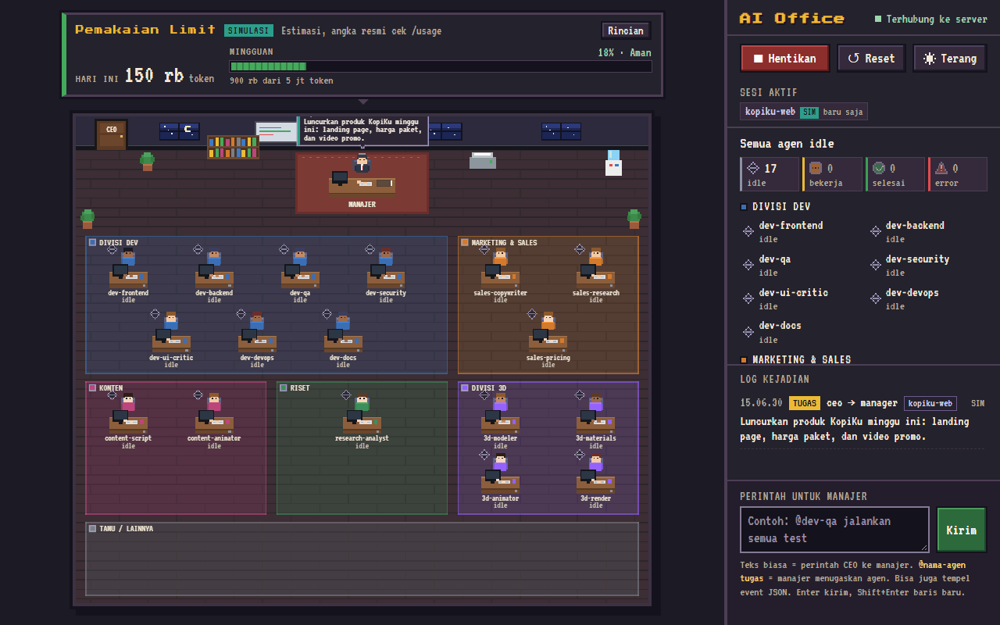
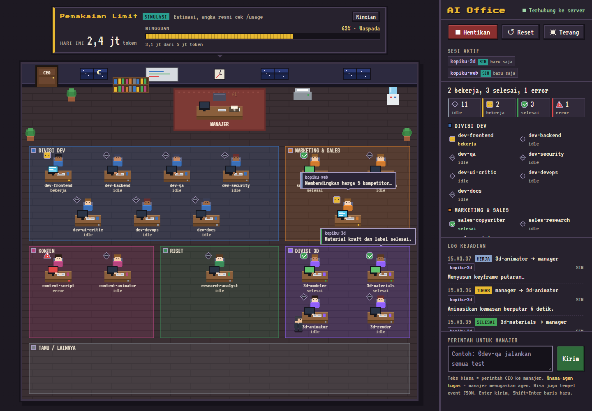
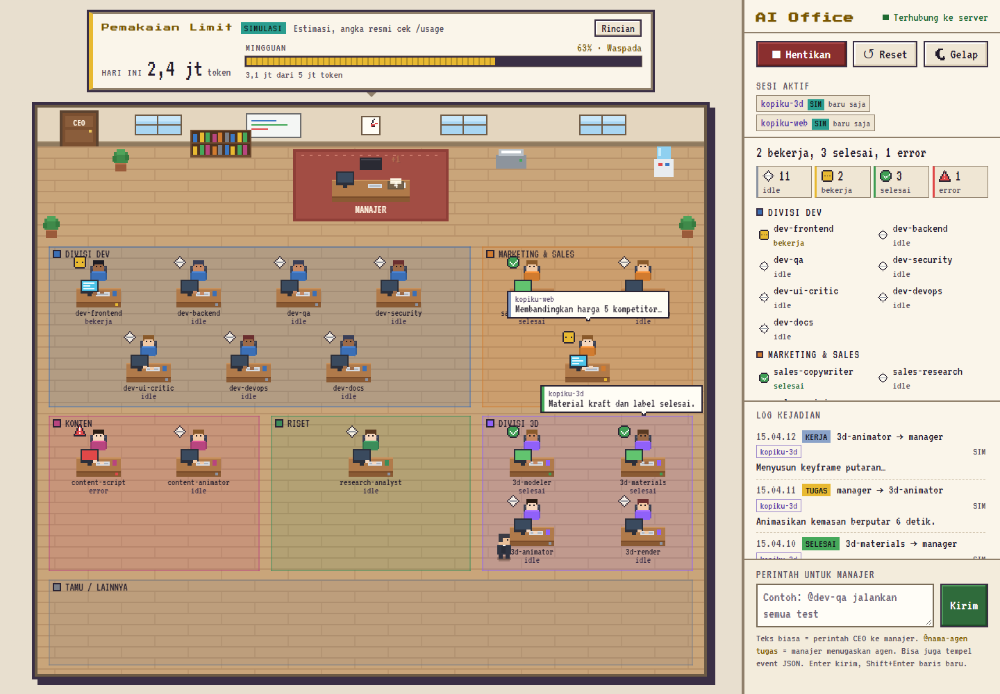

# AI Office

[](https://github.com/mansgaming712-hue/ai-office/actions/workflows/ci.yml)
[](LICENSE)

[Bahasa Indonesia](README.id.md)

AI Office is a pixel-art office that shows Claude Code subagents at work. The main Claude Code session acts as
the manager and delegates tasks to 17 specialist agents; the dashboard animates each delegation, from the
assignment to the report. It is a small local Node server that receives events from Claude Code hooks, plus a
React dashboard that draws the office in a canvas.







The screenshots and the demo use simulated data, not real sessions.

## Features

- **Pixel-art office** on a canvas: the manager, worker desks, and report envelopes.
- **Simulation**: the ▶ Simulasi button plays a sample scenario of about 60 seconds without Claude Code.
- **Command box**: plain text is sent to the manager, `@agent-name` assigns a specific agent, and you can paste
  a JSON event.
- **Claude Code hooks**: delegations from real Claude Code sessions are sent to the dashboard automatically.
- **Active sessions**: a list of projects that had an event in the last 10 minutes.
- **Usage Limit panel**: estimated token usage from the local Claude Code logs. These are not official numbers.
- **Local or token mode**: local mode is reachable only from this computer. Token mode is for remote access
  behind HTTPS (see [Deploy to a VPS](#deploy-to-a-vps)).
- **Light and dark theme**: follows the system setting by default and is saved in the browser.
- **Four agent states**: `idle`, `working`, `done`, and `error`. `error` means the agent reported
  `STATUS: BUTUH BANTUAN` (Indonesian for "needs help"). Each state has an icon, a label, and a count.
- **Responsive layout** from phones to large screens. Animations follow `prefers-reduced-motion`.
- **Autostart** on Windows, macOS, and Linux (optional, no admin rights needed).
- **Validation and tests**: `npm run agents:validate` and `npm test`.

The UI text, server messages, and agent definitions are written in Indonesian. Translations are welcome.

## Requirements

| Need | Version | Notes |
| --- | --- | --- |
| Node.js | 22.12 or newer | One minimum for everything: server, hooks, build, and tests. Checked by `server/requireNode.js` (also before `npm run build` and `npm test`). Older versions print a message and exit with code 1. |
| npm | comes with Node.js | |
| Claude Code (`claude` CLI) | any recent version | Only needed for real delegation. Simulation does not need it. |

Check your version with `node -v`.

## Install

The commands after the Node.js step are the same in bash, zsh, and PowerShell.

### Windows

1. Install Node.js 22 LTS or newer, either with `winget install OpenJS.NodeJS.LTS` in PowerShell or from
   https://nodejs.org/. Open a new terminal afterwards.
2. Install Git if you do not have it: https://git-scm.com/.
3. Run:

```powershell
git clone https://github.com/mansgaming712-hue/ai-office.git
cd ai-office
npm ci
npm run agents:install
npm run hooks:install-user
```

### macOS

1. Install Node.js 22 LTS or newer, with Homebrew (`brew install node`) or the installer from
   https://nodejs.org/. Check with `node -v`.
2. Run:

```bash
git clone https://github.com/mansgaming712-hue/ai-office.git
cd ai-office
npm ci
npm run agents:install
npm run hooks:install-user
```

### Linux

1. Install Node.js 22 with a version manager such as [nvm](https://github.com/nvm-sh/nvm) or
   [fnm](https://github.com/Schniz/fnm). Distribution packages are often too old, so check the version with
   `node -v` before you continue.

```bash
nvm install 22
nvm use 22
```

2. Run:

```bash
git clone https://github.com/mansgaming712-hue/ai-office.git
cd ai-office
npm ci
npm run agents:install
npm run hooks:install-user
```

What the last three commands do:

- `npm run agents:install` copies `agents/*.md` to `~/.claude/agents/` (on Windows, `%USERPROFILE%\.claude\agents\`).
  A file that already exists and differs is not overwritten. Add `-- --force` to overwrite it.
- `npm run hooks:install-user` adds the AI Office hooks to `~/.claude/settings.json`. It merges with your
  existing settings, writes a backup first, and is safe to run again. It refuses a project path that contains
  `"`, a line break, `$`, a backtick, `%`, or `!`, because hook commands run through a shell. Move the project
  to another folder in that case.
- Hooks only apply to Claude Code sessions that start **after** the install. Restart any session that was already
  running. To remove the hooks, run `npm run hooks:uninstall-user`.

## Run

```bash
npm start
```

PowerShell uses the same command. Open **http://localhost:3000**. `npm start` builds the UI (`prestart`) and then
starts the server.

- If the UI is already built, `npm run serve` starts the server without building.
- Another port: `PORT=3001 npm run serve` (bash, zsh) or `$env:PORT=3001; npm run serve` (PowerShell).
- **▶ Simulasi** plays the sample scenario without Claude Code. **↺ Reset** clears the office and the log.
- **Command box**: plain text is a command to the manager. `@dev-qa run the tests` asks the manager to assign
  that agent. Click a desk or an agent name to fill in `@name`.
- For real delegation, run `claude` in the project folder. The rules in `CLAUDE.md` apply to sessions started
  from this folder.

## Autostart

Autostart starts the AI Office server when you log in. It is optional. The server listens on `127.0.0.1:3000` in
this setup. Run these commands from the project folder. They work the same in bash, zsh, and PowerShell.

```bash
npm run autostart:install      # install autostart and start the server
npm run autostart:status       # show autostart and server state (read only)
npm run autostart:stop         # stop the server now; autostart stays installed
npm run autostart:uninstall    # remove autostart and stop the server
```

To see what the install would write without changing anything:

```bash
node scripts/autostart.mjs install --dry-run
```

### Autostart: Windows

- Creates a shortcut named "AI Office" in your user Startup folder. No admin rights needed.
- A hidden launcher (`scripts/windows/start-ai-office.vbs`) runs a supervisor. The supervisor restarts the server
  after a crash, waiting 5, 10, 20, 40, and then 60 seconds. After 8 crashes in a row it stops.
- Server log: `logs/server.log`. When it grows above 5 MB, it moves to `logs/server.log.1`.
- If the server is already running from `npm start` on port 3000, autostart does not start a second copy.

### Autostart: macOS

- Creates a LaunchAgent at `~/Library/LaunchAgents/com.ai-office.server.plist` and loads it with `launchctl`.
  No admin rights needed.
- Server log: `logs/server.log` in the project folder.

### Autostart: Linux

- Creates a systemd user unit at `~/.config/systemd/user/ai-office.service`. It needs `systemctl --user`, so a
  normal login session is required.
- The server starts when you log in. To keep it running without a login (for example on a headless machine),
  run this yourself. The installer does not run it:

```bash
sudo loginctl enable-linger "$USER"
```

- Logs: `journalctl --user -u ai-office.service -f`.

### Autostart notes (all platforms)

- The installer records the path of the Node.js executable it runs with. If you switch Node.js versions with
  nvm, fnm, asdf, or Volta, run `npm run autostart:install` again. The old path may no longer exist. The
  installer does not warn about this yet.
- Autostart runs `server/index.js` from the project folder every time you log in, and the user-level hooks run
  `hooks/send-event.mjs` in every Claude Code session. Keep the project in a folder that only your own account
  can write to, so nobody else can change the code that runs as you.

## Configuration

### `.env`

```bash
cp .env.example .env
```

```powershell
Copy-Item .env.example .env
```

- Every value in `.env.example` may be left empty. Without values, the server runs in local mode
  (`127.0.0.1:3000`, no login).
- The `.env` file is ignored by git. Never commit it.
- Variables that already exist in the environment (shell, systemd, or the `env` section of Claude Code's
  `settings.json`) are **not** overwritten by `.env` (see `server/loadEnv.js`).
- The server and the hook (`hooks/send-event.mjs`) both read `.env` from the project folder.
- Loading `.env` uses Node's built-in `process.loadEnvFile`, so no extra package is needed.
- The full list of variables is in [Environment variables](#environment-variables).

### `limit-config.json` (optional)

```bash
cp limit-config.example.json limit-config.json
```

```powershell
Copy-Item limit-config.example.json limit-config.json
```

Set `weeklyTokenLimit` to your estimated weekly token limit. The limit bar in the panel only appears when the
value is greater than 0. The file is ignored by git. Each key is explained in [Limit configuration](#limit-configuration).

## Agents

17 specialists are defined in `agents/` (the source). `npm run agents:install` copies them to `~/.claude/agents/`.

| Division | Agents |
| --- | --- |
| Dev | dev-frontend, dev-backend, dev-qa, dev-security, dev-ui-critic, dev-devops, dev-docs |
| Marketing & Sales | sales-copywriter, sales-research, sales-pricing |
| Content | content-script, content-animator |
| Research | research-analyst |
| 3D | 3d-modeler, 3d-materials, 3d-animator, 3d-render |

Each agent sets its model in the `model:` field of its frontmatter. Only `haiku` and `sonnet` are allowed.
`haiku` is used by dev-docs, research-analyst, and 3d-render, and `sonnet` by the rest. The validation in
`scripts/agent-files.mjs` rejects any other value, such as `opus`.

The manager rules are in `CLAUDE.md`.

```bash
npm run agents:validate                # check frontmatter, unique names, models, specialist rules, installed copies
npm run agents:install                 # install or update in ~/.claude/agents (does not overwrite changed files)
npm run agents:install -- --force      # overwrite changed files too
```

After you pull changes that add an agent, run `npm run agents:install`. Until then, `npm run agents:validate`
reports the agent as not installed.

## Event format

All events (simulation, command box, and hooks) use one format:

```json
{ "type": "assign", "from": "manager", "to": "dev-frontend", "message": "Build the navbar", "time": "2026-11-08T02:30:00.000Z" }
```

- `type`: `assign` | `working` | `done` | `blocked` | `report`
- The Indonesian keys `tipe`, `dari`, `ke`, `pesan`, and `waktu` are also accepted.
- `time` may be omitted; the server fills it in. Special names: `manager` and `ceo`.
- `project` (optional): the name of the Claude Code session folder, up to 64 characters. Set by the hook.
- `tokens` (optional): `{ input, output, cacheRead, cacheCreation }`, only sent with `SubagentStop`. Used for
  per-agent usage statistics.

To send an event by hand:

```bash
curl -X POST http://localhost:3000/api/events \
  -H "Content-Type: application/json" \
  -d '{"type":"done","from":"dev-qa","to":"manager","message":"9 tests passed"}'
```

```powershell
Invoke-RestMethod -Method Post -Uri http://localhost:3000/api/events -ContentType 'application/json' `
  -Body '{"type":"done","from":"dev-qa","to":"manager","message":"9 tests passed"}'
```

In token mode, add the header `Authorization: Bearer <your-token>`. In bash: `-H "Authorization: Bearer $AI_OFFICE_TOKEN"`.
In PowerShell: `-Headers @{ Authorization = "Bearer $env:AI_OFFICE_TOKEN" }`. See
[Authentication and server modes](#authentication-and-server-modes).

| Endpoint | Purpose | Token mode |
| --- | --- | --- |
| `POST /api/events` | one event or an array of up to 50. Requires `Content-Type: application/json` | Bearer header or session cookie required, otherwise `401` |
| `GET /api/events` | the last 300 events | Bearer header or session cookie required, otherwise `401` |
| `GET /api/usage` | `{ok, usage}`: token usage statistics (local estimate) | Bearer header or session cookie required, otherwise `401` |
| `GET /api/health` | server status. Returns only `{ok:true}`, without client or event counts | open |
| `GET /api/session` | `{ok, authRequired, authenticated}` | open |
| `POST /api/login` | body `{"token":"..."}` (JSON). Sets the `aio_session` cookie. Wrong token: `401`. Too many tries: `429` | open (local mode always returns `{ok:true}`) |
| `POST /api/logout` | clears the session cookie in this browser. Requires `Content-Type: application/json` (body may be `{}`) | open |
| `WS /ws` | sends `{kind:"hello", events}`, then `{kind:"usage", usage}`, then `{kind:"event", event}` and `{kind:"usage", usage}` when things change | Bearer header or session cookie required, otherwise `401`. Closed with code `4401` when the session expires |

## Claude Code hooks

The hooks are installed at **user level** (`~/.claude/settings.json`), so they apply to sessions from any folder.
The project file `.claude/settings.json` contains `{}` and installs no hooks.

```bash
npm run hooks:install-user     # install the AI Office hooks into ~/.claude/settings.json
npm run hooks:uninstall-user   # remove the AI Office hooks from ~/.claude/settings.json
```

The installer (`scripts/install-user-hooks.mjs`, shared logic in `scripts/user-hooks.mjs`):

- **Merges, does not overwrite.** Other keys and hooks in the settings file are kept. Running it several times does
  not add duplicate entries (it is idempotent).
- **Backs up.** Before writing, the old file is copied to `~/.claude/settings.json.bak-YYYYMMDD-HHMMSS` (with
  `-1`, `-2`, and so on added if that name exists). If `settings.json` does not exist yet, no backup is made.
- **Writes atomically** (temporary file, then rename). If the existing JSON is broken, nothing is written and the
  exit code is `1`.
- **Checks the project path.** See the list under [Install](#install).
- **Uses absolute paths.** The hook command points to the absolute path of `hooks/send-event.mjs` in the folder
  where the installer ran. If you move the project, run the installer again from the new location. Entries from the
  old location are not recognized from the new one. Run `npm run hooks:uninstall-user` from the old folder first, or
  remove the old `send-event.mjs` entry from `settings.json` by hand (after making a backup).
- **Applies to new sessions.** Sessions that were already running need to be restarted.
- To test without touching your real settings, point `AI_OFFICE_USER_SETTINGS` at another file (see
  [Environment variables](#environment-variables)).

Hooks that are installed (events and matchers match `desiredHooks` in `scripts/user-hooks.mjs`):

| Hook | AI Office event |
| --- | --- |
| `PreToolUse` with tool `Agent` or `Task` | `assign` from manager to subagent (message = the task description) |
| `SubagentStart` | `working` for the subagent |
| `PreToolUse` with any other tool (async) | `working` from the subagent (or manager), for example `Edit · App.jsx` |
| `SubagentStop` | `done` or `blocked`, read from the `STATUS:` line of the report |
| `PostToolUse` with tool `Agent` or `Task` | `report` or `blocked`, with a summary of the report |

Behaviour at runtime:

- Claude Code waits for a hook for at most **3 seconds** (the timeout written by the installer).
- The hook sends the event to the server with an **800 ms** limit (`AI_OFFICE_TIMEOUT_MS`, default in
  `hooks/send-event.mjs`). Events are not retried.
- If the server is down, the hook exits silently with code 0 and prints nothing, so Claude Code is not affected.
  A failed event is not recorded anywhere, unless `AI_OFFICE_DEBUG=1` is set.
- Every event carries `project`: the session folder name (the basename of `CLAUDE_PROJECT_DIR`, or the working
  directory when that variable is empty). The **Active sessions** list shows sessions with an event in the last
  10 minutes.
- `SubagentStop` events also carry `tokens`, read from the subagent transcript, for per-agent statistics.
- Common secret patterns (tokens, API keys, passwords) are masked before sending.
- If an identical event (same type, from, to, message, and project) arrives again within 3 seconds, the server
  drops it so the animation does not show it twice.

To test without Claude Code (the server must be running):

```bash
npm run demo:hooks              # sample scenario with about 1.8 s between steps
npm run demo:hooks -- --fast    # no delay
npm run demo:hooks -- --asli    # payload shape of recent Claude Code: background agents, and reports
                                # read from the transcript file through SubagentHandback
```

To send hook events to another server: `AI_OFFICE_URL=http://127.0.0.1:3001/api/events`. Debug output:
`AI_OFFICE_DEBUG=1`.

Not tested in this code base: whether the `"env"` section of `~/.claude/settings.json` passes variables to user-level
hooks. Store hook variables in `.env` or in the system environment for now.

## Usage Limit panel

The "Pemakaian Limit" panel above the office shows an **estimate** of Claude Code token usage. Official numbers are
in `/usage` inside Claude Code. The panel does not call any model or API.

- **Source:** local logs in `~/.claude/projects/**/*.jsonl` (including `subagents/`). Tokens are read from
  `message.usage`, de-duplicated by `message.id`, and grouped by local hour. Per-agent tokens come from
  `SubagentStop` events (a 7-day window).
- **When it is recalculated:** every 60 seconds, and about 2 seconds after a `SubagentStop` event that carries
  `tokens`.
- **Weekly formula:** input + output + cache write, plus cache read when `countCacheRead` is `true`.
- **Bar colours:** green below 60%, yellow from 60% to 85%, red above 85%. Above 85%, the panel shows the warning
  "Limit hampir habis, hemat mode" (Indonesian for "limit almost used up, save mode"). The bar only appears when
  `weeklyTokenLimit` is set.
- **No data:** if the logs cannot be read (folder missing, empty, or in an unknown format), the panel shows
  "data tidak tersedia" with the reason.
- **Privacy:** the results and the logs contain only numbers and agent names. No paths, message text, or session
  names.
- **Cache:** `data/usage-cache.json` and `data/usage-agents.json` are created automatically. The `data/` folder is
  ignored by git.

### Limit configuration

Put `limit-config.json` in the project root. A reference example is in `limit-config.example.json`. The values
below are only examples:

```json
{
  "weeklyTokenLimit": 5000000,
  "weekResetDay": 1,
  "weekResetHour": 0,
  "countCacheRead": false
}
```

| Key | Value | Notes |
| --- | --- | --- |
| `weeklyTokenLimit` | a number above 0, or `0` | estimated weekly token limit. `0` means no limit, and the bar is hidden |
| `weekResetDay` | `0`–`6` or `null` | reset day (0 = Sunday, 1 = Monday, ..., 6 = Saturday). `null` = rolling 7-day window |
| `weekResetHour` | `0`–`23` | reset hour, local time of the computer. Default `0` |
| `countCacheRead` | `true` / `false` | `true` = cache-read tokens are counted too. Default `false` |

The file is read again on every cycle, so the server does not need a restart. Another location can be set with
`AI_OFFICE_LIMIT_CONFIG`. Broken JSON is treated as if the file does not exist.

### CLI and sample data

```bash
npm run usage                 # summary in the terminal (estimate)
npm run usage -- --json       # JSON output, same shape as GET /api/usage → usage
```

`npm run usage` does not need the server. Its exit code is always `0`, including when no data is available.

Sample data, when there are no real Claude Code logs:

```bash
npm run usage:sample                                                # writes tests/fixtures/usage-sample/
AI_OFFICE_CLAUDE_DIR=tests/fixtures/usage-sample npm run usage      # bash, zsh
```

```powershell
npm run usage:sample
$env:AI_OFFICE_CLAUDE_DIR = "tests\fixtures\usage-sample"; npm run usage; Remove-Item Env:AI_OFFICE_CLAUDE_DIR
```

`npm run usage:sample` deletes the `projects/` folder inside the target folder before it writes new data. Do not
point it at a real Claude Code log folder.

`AI_OFFICE_CLAUDE_DIR` is the base folder for the logs (default `~/.claude`). If that folder has no `projects/`
subfolder, the folder itself is scanned.

## Authentication and server modes

Always on: the `Host` header is checked (protection against DNS rebinding), `Origin` headers from other sites are
rejected for the API and the WebSocket, request bodies are limited to 64 KB, the page is sent with a strict
Content Security Policy, and by default the server log records only event metadata (type, sender, recipient,
and message length). The server has three modes:

1. **Local mode** (default). Without a token, the server listens only on `127.0.0.1` and can be opened only from
   this computer. There is no login.
2. **Token mode**. Active when `AI_OFFICE_TOKEN` or `AI_OFFICE_TOKEN_FILE` is set.
   - The browser shows a token screen. After a correct token, the server sets the `aio_session` cookie (HttpOnly,
     SameSite=Strict, and `Secure` when served over HTTPS), valid for 7 days. The **Keluar** button (Indonesian for
     "Log out") only clears the cookie in that browser. Changing the token ends all sessions.
   - Hooks and curl send the header `Authorization: Bearer <token>`.
   - Ten failed logins from one IP address block that IP for 15 minutes (`429`).
   - The token is never written to logs, responses, or URLs.
3. **Open mode**. Happens when `HOST` is not a loopback address, when `AI_OFFICE_ALLOWED_HOSTS` is set, or when
   `AI_OFFICE_TRUST_PROXY=1`. A token of at least 32 characters is required. Without it, the server refuses to
   start (exit code 1). `AI_OFFICE_TRUST_PROXY=1` is also allowed only with a loopback `HOST` (Nginx on the same
   machine). For internet access, follow [Deploy to a VPS](#deploy-to-a-vps) (Nginx and HTTPS).

Create a strong token (32 random bytes, 43 characters) and run token mode on your own computer.

Bash, zsh (Linux, macOS, Git Bash):

```bash
mkdir -p ~/.ai-office
(umask 077 && npm run -s token > ~/.ai-office/token)
AI_OFFICE_TOKEN_FILE="~/.ai-office/token" npm run serve
```

PowerShell (not tested yet):

```powershell
New-Item -ItemType Directory -Force -Path "$HOME\.ai-office" | Out-Null
npm run -s token > "$HOME\.ai-office\token"
$env:AI_OFFICE_TOKEN_FILE = "$HOME\.ai-office\token"
npm run serve
```

The `-s` flag is required so npm does not add a title line to the file. The token file must contain one line, at
most 4 KB, in UTF-8 (with or without BOM) or in UTF-16 with BOM (what `>` produces in Windows PowerShell 5.1).
Keep the token file outside the project folder and never commit it.

## Environment variables

Server (`server/index.js`):

| Variable | Default | Purpose |
| --- | --- | --- |
| `HOST` | `127.0.0.1` | listen address. Anything other than a loopback address (`127.0.0.1`, `localhost`, `::1`) = open mode |
| `PORT` | `3000` | HTTP port |
| `AI_OFFICE_TOKEN` | empty | shared secret. Enables token mode. Used first when set |
| `AI_OFFICE_TOKEN_FILE` | empty | path to a file with the token (`~` = home folder). Read when `AI_OFFICE_TOKEN` is empty. A bad file gives a warning, and the server runs as if there were no token |
| `AI_OFFICE_ALLOWED_HOSTS` | empty | comma-separated host names allowed in the `Host` and `Origin` headers. Setting it = open mode |
| `AI_OFFICE_TRUST_PROXY` | empty | only active when `1`: use `X-Real-IP` and `X-Forwarded-Proto` from Nginx. Requires a loopback `HOST`. Counts as open mode |
| `AI_OFFICE_DEV_ORIGINS` | empty | comma-separated dev server origins (for example `http://localhost:5173`) allowed in local mode. Used when developing the UI with `npx vite` |
| `AI_OFFICE_LOG_MESSAGES` | empty | only active when `1`: event message text is also written to the log (for temporary debugging) |
| `AI_OFFICE_CLAUDE_DIR` | `~/.claude` | base folder of the Claude Code logs for the [Usage Limit panel](#usage-limit-panel) |
| `AI_OFFICE_LIMIT_CONFIG` | `limit-config.json` in the project root | path to the limit configuration file |

Hook (`hooks/send-event.mjs`):

| Variable | Default | Purpose |
| --- | --- | --- |
| `AI_OFFICE_URL` | `http://127.0.0.1:3000/api/events` | where events are sent. `http://` is allowed only for loopback. Other hosts must use `https://`, otherwise no events are sent |
| `AI_OFFICE_TOKEN` | empty | sent as `Authorization: Bearer` |
| `AI_OFFICE_TOKEN_FILE` | empty | path to the token file, read when `AI_OFFICE_TOKEN` is empty. Recommended: values in the `"env"` section are passed to every Claude Code subprocess, a file is not |
| `AI_OFFICE_TIMEOUT_MS` | `800` | request timeout (maximum 60000) |
| `AI_OFFICE_DEBUG` | empty | `1` = show errors on stderr. The token is never printed |

Hook installer (`scripts/user-hooks.mjs`):

| Variable | Default | Purpose |
| --- | --- | --- |
| `AI_OFFICE_USER_SETTINGS` | `~/.claude/settings.json` | settings file to install into or remove from. For testing only: point it at another file, not your real settings |

All of the variables above can also be written in `.env` (see [Configuration](#configuration)).

## Deploy to a VPS

The full guide is in [`docs/DEPLOY.md`](docs/DEPLOY.md) (Indonesian only; an English translation is open as a good
first issue). It covers costs, one-time setup with `deploy/setup-vps.sh` (Nginx, HTTPS with Let's Encrypt, firewall,
systemd), pointing the hooks at the VPS, updates, rollback, and token rotation. Read the costs and steps before you
rent a server, buy a domain, or run scripts on a server.

## Tests

```bash
npm test
```

The tests cover the event format, the hook mapping, the HTTP server and WebSocket, the hook scripts (real processes),
the animation engine and the simulation scenario, validation of agent files (including the allowed models), the
hook configuration, the user-level hook installer, token authentication (login, session cookie, Bearer header,
token from a file), usage statistics (`usage`, `/api/usage`, and the panel), security regressions, the autostart
script, and a static check of the deploy kit (`deploy/` and `docs/DEPLOY.md`). The shell syntax check of the deploy
scripts (`bash -n`) is skipped when `bash` is not in `PATH`.

Other checks:

```bash
npm run build                  # build the UI into dist/
npm run smoke                  # start the server on a free port and check GET /api/health
npm run agents:validate        # check the agent files
```

CI (`.github/workflows/ci.yml`) runs the build and tests on Ubuntu, Windows, and macOS with Node 22.12 and the
current LTS. The actions are pinned to commit SHAs.

## Project structure

```
agents/                    17 subagent definitions (source), including the 3D division (3d-*.md)
CLAUDE.md                  manager rules
.env.example               configuration example (copy to .env)
limit-config.example.json  weekly limit example (copy to limit-config.json)
.github/                   CI workflow, issue templates, and pull request template
data/                      usage statistics cache (created automatically, git-ignored)
logs/                      server log from autostart (created automatically, git-ignored)
dist/                      UI build output (npm run build)
shared/                    event format, roster, hook mapping, token usage (used by server, hooks, and UI)
server/                    HTTP and WebSocket server, token authentication, token sources, loadEnv.js, usage.js
hooks/                     Claude Code hook scripts (send-event.mjs, transcript-tokens.mjs)
src/                       React and canvas UI
src/office/                animation engine, layout, pathfinding, canvas renderer
src/sim/                   simulation scenario
src/ui/                    React components (token screen, Usage Limit panel)
src/usage.js               validation and formatting of usage data for the UI
src/sessions.js            project names and the active sessions list
scripts/                   agent install and validation, user-level hook installer and remover, usage report,
                           hook demo, token generator, autostart
scripts/windows/           Windows autostart (launcher, supervisor, install, uninstall, stop)
deploy/                    VPS kit: setup-vps.sh, update.sh, rotate-token.sh, lib.sh, systemd, Nginx, env example
docs/                      DEPLOY.md (Indonesian) and images for this README
tests/                     Vitest
```

## Troubleshooting

- **Node.js is too old.** The server prints a message and exits with code 1. Check `node -v` and install a version
  from [Requirements](#requirements). If you use autostart, run `npm run autostart:install` again after the change.
- **`npm run build` or `npm test` fails.** Check the Node.js version against the table in [Requirements](#requirements).
- **Port 3000 is already in use.** Start on another port, for example `PORT=3001 npm run serve`. Then point the
  hooks to it with `AI_OFFICE_URL=http://127.0.0.1:3001/api/events`.
- **Hooks do not show delegations in a session that was already open.** Hooks apply only to sessions started after
  `npm run hooks:install-user`. Restart Claude Code.
- **Events do not arrive.** Run the hook with `AI_OFFICE_DEBUG=1` to see errors on stderr, and check that the server
  is running (`http://127.0.0.1:3000/api/health` should return `{"ok":true}`).
- **Autostart does not work.** Run `npm run autostart:status`. On Linux, check that `systemctl --user` works in your
  session (`journalctl --user -u ai-office.service -e` shows the last log lines). On Windows and macOS, the server
  log is `logs/server.log` in the project folder.
- **The installer refuses the project path.** The path contains a character that the shell could expand (see
  [Claude Code hooks](#claude-code-hooks)). Move the project to a folder with a simpler path.

## Contributing

See [CONTRIBUTING.md](CONTRIBUTING.md) for setup, workflow, test rules, and how to add an agent. Please follow the
[Code of Conduct](CODE_OF_CONDUCT.md).

## Security

- **Never commit `.env`**, `limit-config.json`, token files, or the contents of `data/` and `logs/`. Keep the token
  outside the project folder (for example `~/.ai-office/token`).
- **Report vulnerabilities privately.** Use *Report a vulnerability* on the
  [Security tab](https://github.com/mansgaming712-hue/ai-office/security) of this repository (a GitHub Security
  Advisory). Do not open a public issue for a security problem. See [SECURITY.md](SECURITY.md).

More detail on server modes and authentication is in [Authentication and server modes](#authentication-and-server-modes).

## License

AI Office is released under the MIT License. See [LICENSE](LICENSE).
