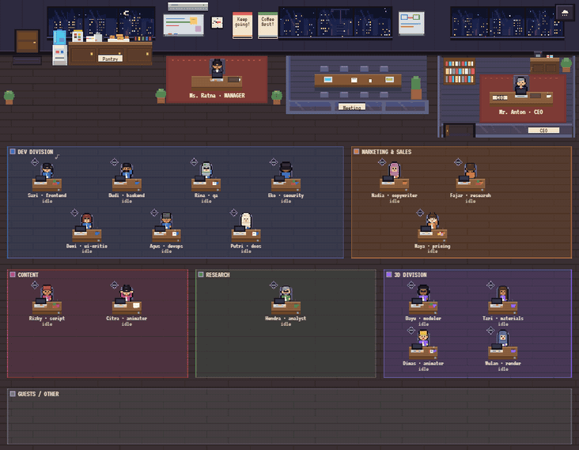

# AI Office

[](https://github.com/mansgaming712-hue/ai-office/actions/workflows/ci.yml)
[](LICENSE)


AI Office is a pixel-art office where your Claude Code manager and its 17 specialist agents work in front of you.
Kantor pixel-art tempat manajer Claude Code dan 17 agen spesialisnya bekerja, terlihat langsung di layar Anda.



**English** | [Bahasa Indonesia](#bahasa-indonesia)

## English

### Features

- **Pixel-art office** in a Jakarta style, with a manager desk, specialist desks, and a live event log.
- **Real tasks:** type a task in the command box. The server starts Claude Code as the manager, in a new folder
  under `output/`. Open the result from the **Tasks** panel.
- **Demo:** the **Demo** button plays a sample task (about 54 seconds) from the server, without Claude Code.
  **▶ Simulation** plays a local animation, and **↺ Reset** clears the office and the log.
- **Live hooks:** delegations from your Claude Code sessions appear on the dashboard once the hooks are installed.
- **Usage panel:** an estimate of token usage from your local Claude Code logs. It is not an official number.
- **Local or token mode**, light and dark theme, English and Bahasa Indonesia interface.
- **Autostart** on Windows, macOS, and Linux (optional).
- **Your own divisions:** add a division as plain data (JSON and Markdown), from a skeleton or a starter pack. Up to 12 divisions. See [Custom divisions](#custom-divisions).

### Quick start

You need Node.js 22.12 or newer. Claude Code is needed only for real tasks; the demo runs without it.

Open a terminal in the folder where you want the project, then:

#### Windows (PowerShell)

Install Node.js if needed: `winget install OpenJS.NodeJS.LTS` (open a new terminal afterwards).

```powershell
git clone https://github.com/mansgaming712-hue/ai-office.git
cd ai-office
npm run setup
npm start
```

#### macOS (Terminal)

Install Node.js if needed: `brew install node` (or the installer from https://nodejs.org/).

```bash
git clone https://github.com/mansgaming712-hue/ai-office.git
cd ai-office
npm run setup
npm start
```

#### Linux

Install Node.js 22 with [nvm](https://github.com/nvm-sh/nvm): `nvm install 22`, then `nvm use 22`.

```bash
git clone https://github.com/mansgaming712-hue/ai-office.git
cd ai-office
npm run setup
npm start
```

Then open the link that `npm start` prints. It looks like `http://localhost:3000/#key=...`. The part after `#key=`
is the runner key, which tasks and the demo need in local mode. If you lose the link, run `npm run open` in a second
terminal in the project folder.

### Install and setup

- **Requirements:** Node.js 22.12 or newer, npm, and (for real tasks) the Claude Code CLI (`claude`), installed and
  logged in. Install it with `npm install -g @anthropic-ai/claude-code`.
- **`npm run setup`** checks the Node.js version, runs `npm ci` and the build, installs the agents into
  `~/.claude/agents`, adds the hooks to `~/.claude/settings.json`, and checks the Claude Code CLI. Use
  `npm run setup -- --no-claude` if you do not use Claude Code yet, or `npm run setup -- --dry-run` to see the steps only.
- **Manual alternative:** `npm run agents:install` and `npm run hooks:install-user`.
- Hooks apply only to Claude Code sessions that start **after** the install. Restart any session that was already open.
  To remove the hooks: `npm run hooks:uninstall-user`.
- **Your first task:** start the server, open the link, type a plain sentence in the command box, and press Enter.
  The **Tasks** panel shows the task as running. When it is done, click **Result** to read `RESULT.md` and the other
  files. The files are also in `output/<date-time>-<slug>/`.
- Plain text goes to the real runner when it is ready (otherwise it only plays as an animation). `@agent-name task`
  always only plays an animation for that agent.
- **Security note (local mode):** local mode without a token can be reached by every account and every process on this computer, and the hooks send events to whatever process holds port 3000. On a shared or multi-user computer, use
  token mode by setting `AI_OFFICE_TOKEN_FILE`. Details: [Authentication and server modes](docs/REFERENCE.md#authentication-server-modes-and-the-runner-key).
- Settings (`.env`, `limit-config.json`, runner variables): see [docs/REFERENCE.md](docs/REFERENCE.md#environment-variables).

### Example tasks

Paste these into the command box. Each one runs as a separate task.

Content for TikTok:

```text
Write a 25-second TikTok script for an iced palm sugar latte promo, with a hook in the first 3 seconds, and an Instagram caption.
```

Market research on a local product:

```text
Research iced palm sugar latte prices at cafes around South Jakarta. Give the price range, the sources you used, and the limits of the data.
```

Sales caption:

```text
Write 3 sales captions for a 250 ml bottled palm sugar latte, aimed at university students. Casual tone, one call to action each.
```

Website audit:

```text
Audit the landing page https://example.com. Fetch the page with WebFetch, then review the copy, the heading structure, and the call to action. Write the findings in RESULT.md.
```

The runner has no Bash, PowerShell, or MCP tools, and it reads and writes only inside its own task folder. So the audit reads the page with WebFetch only and cannot run speed tests with local tools.

### Agents

17 specialists, defined in `agents/` and listed in `shared/roster.js`. The manager rules are in `CLAUDE.md`.

| Division | Agents |
| --- | --- |
| Dev | dev-frontend, dev-backend, dev-qa, dev-security, dev-ui-critic, dev-devops, dev-docs |
| Marketing & Sales | sales-copywriter, sales-research, sales-pricing |
| Content | content-script, content-animator |
| Research | research-analyst |
| 3D | 3d-modeler, 3d-materials, 3d-animator, 3d-render |

Check the installed agents with `npm run agents:validate`.

### Custom divisions

Add a division from a starter pack (`dev-team`, `content-team`, `research-team`, or `example-legal`) in three lines:

```bash
npm run division:add legal -- --from example-legal   # creates divisions/legal/
npm run agents:install                                # copies the worker files to ~/.claude/agents
npm start                                             # restart the server (stop the old one first)
```

Without `--from`, the command creates a skeleton with one worker and two desks. Add `--dry-run` to preview without writing anything. The server reads `divisions/` only when it starts, so restart it after every change. Run `npm run agents:validate` to check the result. Invalid divisions are skipped, the server still starts, and the reason is listed at `GET /api/divisions`.

Divisions are data, not code, and AI Office never runs them. Worker files may use only the frontmatter keys `name`, `description`, `tools`, and `model`, and once installed Claude Code loads them as subagents. So `npm run agents:install` skips a plugin worker that uses a tool outside the safe list (`Read`, `Glob`, `Grep`, `Write`, `Edit`, `WebSearch`, `TodoWrite`) and exits with code `3`. Read the `tools:` line of any pack you did not write before you add `--allow-risky-tools`. `--force` overwrites only files that AI Office installed and you have not changed. Rules, limits, and how to send a new starter pack: [CONTRIBUTING.md](CONTRIBUTING.md#adding-a-division).

### Troubleshooting

- **Port 3000 is already in use.** Start on another port. macOS and Linux: `PORT=3001 npm start`. Windows PowerShell:
  `$env:PORT=3001; npm start`. Then open http://localhost:3001. Hooks need `AI_OFFICE_URL=http://127.0.0.1:3001/api/events`.
- **Node.js is too old.** The server prints a message and exits. Check `node -v` and install 22.12 or newer (see Quick start).
- **`npm run build` or `npm test` fails.** Check the Node.js version first.
- **The dashboard is empty** ("The office is quiet"). Click **Demo** to see a sample. For real sessions, run
  `npm run hooks:install-user` and start a new Claude Code session.
- **"Claude Code CLI not found".** Install Claude Code and run `claude` once to log in. If the CLI is in a custom
  place, set `AI_OFFICE_CLAUDE_BIN` to its full path before `npm start`.
- **"The runner needs a key".** Open the link printed in the terminal (it contains `#key=`), or run `npm run open`.
  If the server says `Wrong runner key`, the page has an old key: run `npm run open` again.
- **"The runner is busy".** One task or demo runs at a time. Wait for it to finish, or click **Cancel** in the Tasks panel.
- **Autostart or Windows service problems:** see [docs/REFERENCE.md](docs/REFERENCE.md#autostart).

### Contributing and license

Read [CONTRIBUTING.md](CONTRIBUTING.md) before you open a pull request, and follow the [Code of Conduct](CODE_OF_CONDUCT.md).
Report security problems privately, as described in [SECURITY.md](SECURITY.md). Do not open a public issue for them.

Technical reference (hooks, API, environment variables, autostart, tests): [docs/REFERENCE.md](docs/REFERENCE.md).
VPS deployment: [docs/DEPLOY.en.md](docs/DEPLOY.en.md).

AI Office is released under the MIT License. See [LICENSE](LICENSE).

## Bahasa Indonesia

### Fitur

- **Kantor pixel-art** bergaya Jakarta, dengan meja manajer, meja spesialis, dan log kejadian langsung.
- **Tugas sungguhan:** ketik tugas di kotak perintah. Server menjalankan Claude Code sebagai manajer, di folder baru
  di dalam `output/`. Hasilnya dibuka dari panel **Tugas**.
- **Demo:** tombol **Demo** memutar tugas contoh (sekitar 54 detik) dari server, tanpa Claude Code. **▶ Simulasi**
  memutar animasi lokal, dan **↺ Reset** mengosongkan kantor dan log.
- **Hook langsung:** delegasi dari sesi Claude Code Anda muncul di dasbor setelah hook dipasang.
- **Panel Pemakaian Limit:** estimasi pemakaian token dari log Claude Code lokal. Ini bukan angka resmi.
- **Mode lokal atau token**, tema terang dan gelap, antarmuka Bahasa Indonesia dan Inggris.
- **Autostart** di Windows, macOS, dan Linux (opsional).
- **Divisi buatan pengguna:** tambahkan divisi sebagai data biasa (JSON dan Markdown), dari kerangka kosong atau starter pack. Maksimal 12 divisi. Lihat [Divisi buatan pengguna](#divisi-buatan-pengguna).

### Mulai cepat

Anda butuh Node.js 22.12 atau lebih baru. Claude Code hanya diperlukan untuk tugas sungguhan; demo berjalan tanpanya.

Buka terminal di folder tempat Anda ingin menyimpan proyek, lalu:

#### Windows (PowerShell)

Pasang Node.js bila belum ada: `winget install OpenJS.NodeJS.LTS` (buka terminal baru setelahnya).

```powershell
git clone https://github.com/mansgaming712-hue/ai-office.git
cd ai-office
npm run setup
npm start
```

#### macOS (Terminal)

Pasang Node.js bila belum ada: `brew install node` (atau installer dari https://nodejs.org/).

```bash
git clone https://github.com/mansgaming712-hue/ai-office.git
cd ai-office
npm run setup
npm start
```

#### Linux

Pasang Node.js 22 dengan [nvm](https://github.com/nvm-sh/nvm): `nvm install 22`, lalu `nvm use 22`.

```bash
git clone https://github.com/mansgaming712-hue/ai-office.git
cd ai-office
npm run setup
npm start
```

Lalu buka tautan yang dicetak `npm start`. Bentuknya `http://localhost:3000/#key=...`. Bagian setelah `#key=` adalah
runner key, yang dibutuhkan tugas dan demo di mode lokal. Jika tautannya hilang, jalankan `npm run open` di terminal
kedua dari folder proyek.

### Instalasi dan pengaturan

- **Syarat:** Node.js 22.12 atau lebih baru, npm, dan (untuk tugas sungguhan) CLI Claude Code (`claude`) yang sudah
  terpasang dan sudah login. Pasang dengan `npm install -g @anthropic-ai/claude-code`.
- **`npm run setup`** memeriksa versi Node.js, menjalankan `npm ci` dan build, memasang agen ke `~/.claude/agents`,
  menambahkan hook ke `~/.claude/settings.json`, lalu memeriksa CLI Claude Code. Pakai `npm run setup -- --no-claude`
  bila belum memakai Claude Code, atau `npm run setup -- --dry-run` untuk hanya melihat langkahnya.
- **Cara manual:** `npm run agents:install` dan `npm run hooks:install-user`.
- Hook hanya berlaku untuk sesi Claude Code yang dimulai **setelah** pemasangan. Mulai ulang sesi yang sudah terbuka.
  Untuk menghapus hook: `npm run hooks:uninstall-user`.
- **Tugas pertama Anda:** jalankan server, buka tautannya, ketik satu kalimat biasa di kotak perintah, lalu tekan Enter.
  Panel **Tugas** menampilkan tugas sebagai berjalan. Saat selesai, klik **Hasil** untuk membaca `RESULT.md` dan file lain.
  File tersebut juga ada di `output/<tanggal-jam>-<slug>/`.
- Teks biasa dikirim ke runner sungguhan saat runner siap (jika tidak, hanya diputar sebagai animasi). `@nama-agen tugas`
  selalu hanya memutar animasi untuk agen itu.
- **Catatan keamanan (mode lokal):** mode lokal tanpa token bisa dijangkau oleh semua akun dan proses di komputer ini,
  dan hook mengirim event ke proses mana pun yang memegang port 3000. Di komputer bersama atau multi-pengguna, pakai mode
  token dengan mengisi `AI_OFFICE_TOKEN_FILE`. Rincian: [Autentikasi dan mode server](docs/REFERENCE.id.md#autentikasi-mode-server-dan-runner-key).
- Pengaturan (`.env`, `limit-config.json`, variabel runner): lihat [docs/REFERENCE.id.md](docs/REFERENCE.id.md#variabel-lingkungan).

### Contoh tugas

Tempel contoh ini ke kotak perintah. Setiap contoh berjalan sebagai tugas terpisah.

Konten untuk TikTok:

```text
Buatkan skrip TikTok 25 detik untuk promo es kopi susu gula aren, dengan hook di 3 detik pertama, dan caption untuk Instagram.
```

Riset pasar produk lokal:

```text
Riset harga kopi susu gula aren di kafe-kafe sekitar Jakarta Selatan. Berikan rentang harganya, sumber yang kamu pakai, dan batas dari data itu.
```

Caption jualan:

```text
Buatkan 3 caption jualan untuk kopi susu gula aren kemasan botol 250 ml, sasaran mahasiswa, gaya santai, masing-masing dengan satu ajakan membeli.
```

Audit website:

```text
Audit landing page https://example.com. Ambil halamannya dengan WebFetch, lalu nilai copy, struktur judul, dan ajakan tindakan. Tulis temuannya di RESULT.md.
```

Runner ini tidak punya Bash, PowerShell, maupun alat MCP, dan hanya membaca serta menulis di folder tugasnya sendiri. Jadi audit hanya membaca halaman lewat WebFetch dan tidak bisa menjalankan uji kecepatan dengan alat lokal.

### Agen

17 spesialis, didefinisikan di `agents/` dan didaftarkan di `shared/roster.js`. Aturan manajer ada di `CLAUDE.md`.

| Divisi | Agen |
| --- | --- |
| Dev | dev-frontend, dev-backend, dev-qa, dev-security, dev-ui-critic, dev-devops, dev-docs |
| Marketing & Sales | sales-copywriter, sales-research, sales-pricing |
| Konten | content-script, content-animator |
| Riset | research-analyst |
| 3D | 3d-modeler, 3d-materials, 3d-animator, 3d-render |

Periksa agen yang terpasang dengan `npm run agents:validate`.

### Divisi buatan pengguna

Tambahkan divisi dari starter pack (`dev-team`, `content-team`, `research-team`, atau `example-legal`) dalam tiga baris:

```bash
npm run division:add legal -- --from example-legal   # membuat divisions/legal/
npm run agents:install                                # menyalin file worker ke ~/.claude/agents
npm start                                             # mulai ulang server (hentikan yang lama dulu)
```

Tanpa `--from`, perintah membuat kerangka dengan satu worker dan dua meja. Tambahkan `--dry-run` untuk melihat hasilnya tanpa menulis apa pun. Server hanya membaca `divisions/` saat mulai, jadi mulai ulang setelah setiap perubahan. Jalankan `npm run agents:validate` untuk memeriksa hasilnya. Divisi yang tidak valid dilewati, server tetap jalan, dan alasannya tercantum di `GET /api/divisions`.

Divisi hanyalah data, bukan kode, dan AI Office tidak pernah menjalankannya. File worker hanya boleh memakai kunci frontmatter `name`, `description`, `tools`, dan `model`; setelah dipasang, Claude Code memuatnya sebagai subagen. Karena itu `npm run agents:install` melewati worker plugin yang memakai tool di luar daftar aman (`Read`, `Glob`, `Grep`, `Write`, `Edit`, `WebSearch`, `TodoWrite`) dan keluar dengan kode `3`. Periksa baris `tools:` dari paket apa pun yang tidak kamu tulis sebelum memakai `--allow-risky-tools`. `--force` hanya menimpa file yang dipasang AI Office dan belum kamu ubah. Aturan, batas, dan cara mengirim starter pack baru: [CONTRIBUTING.md](CONTRIBUTING.md#adding-a-division) (berbahasa Inggris).

### Pemecahan masalah

- **Port 3000 sudah dipakai.** Jalankan di port lain. macOS dan Linux: `PORT=3001 npm start`. Windows PowerShell:
  `$env:PORT=3001; npm start`. Lalu buka http://localhost:3001. Hook perlu `AI_OFFICE_URL=http://127.0.0.1:3001/api/events`.
- **Versi Node.js terlalu lama.** Server mencetak pesan lalu berhenti. Cek `node -v` dan pasang 22.12 atau lebih baru (lihat Mulai cepat).
- **`npm run build` atau `npm test` gagal.** Periksa versi Node.js dulu.
- **Dasbor kosong** ("Kantor masih sepi"). Klik **Demo** untuk melihat contoh. Untuk sesi sungguhan, jalankan
  `npm run hooks:install-user` lalu mulai sesi Claude Code baru.
- **"CLI Claude Code tidak ditemukan".** Pasang Claude Code dan jalankan `claude` sekali untuk login. Jika CLI ada di lokasi
  khusus, isi `AI_OFFICE_CLAUDE_BIN` dengan path lengkapnya sebelum `npm start`.
- **"Runner butuh key".** Buka tautan yang dicetak di terminal (berisinya `#key=`), atau jalankan `npm run open`.
  Jika server menjawab "Runner key salah.", halaman yang terbuka memakai key lama; jalankan `npm run open` lagi.
- **"Runner sedang sibuk".** Hanya satu tugas atau demo yang berjalan. Tunggu selesai, atau klik **Batalkan** di panel Tugas.
- **Masalah autostart atau layanan Windows:** lihat [docs/REFERENCE.id.md](docs/REFERENCE.id.md#autostart).

### Kontribusi dan lisensi

Baca [CONTRIBUTING.md](CONTRIBUTING.md) sebelum membuka pull request, dan ikuti [Kode Etik](CODE_OF_CONDUCT.md).
Laporkan masalah keamanan secara privat, seperti dijelaskan di [SECURITY.md](SECURITY.md). Jangan membuka issue publik untuk masalah itu.

Referensi teknis (hook, API, variabel lingkungan, autostart, test): [docs/REFERENCE.id.md](docs/REFERENCE.id.md).
Deployment ke VPS: [docs/DEPLOY.md](docs/DEPLOY.md).

AI Office dirilis di bawah Lisensi MIT. Lihat [LICENSE](LICENSE).
